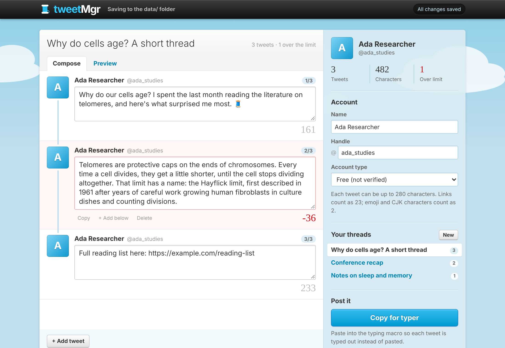
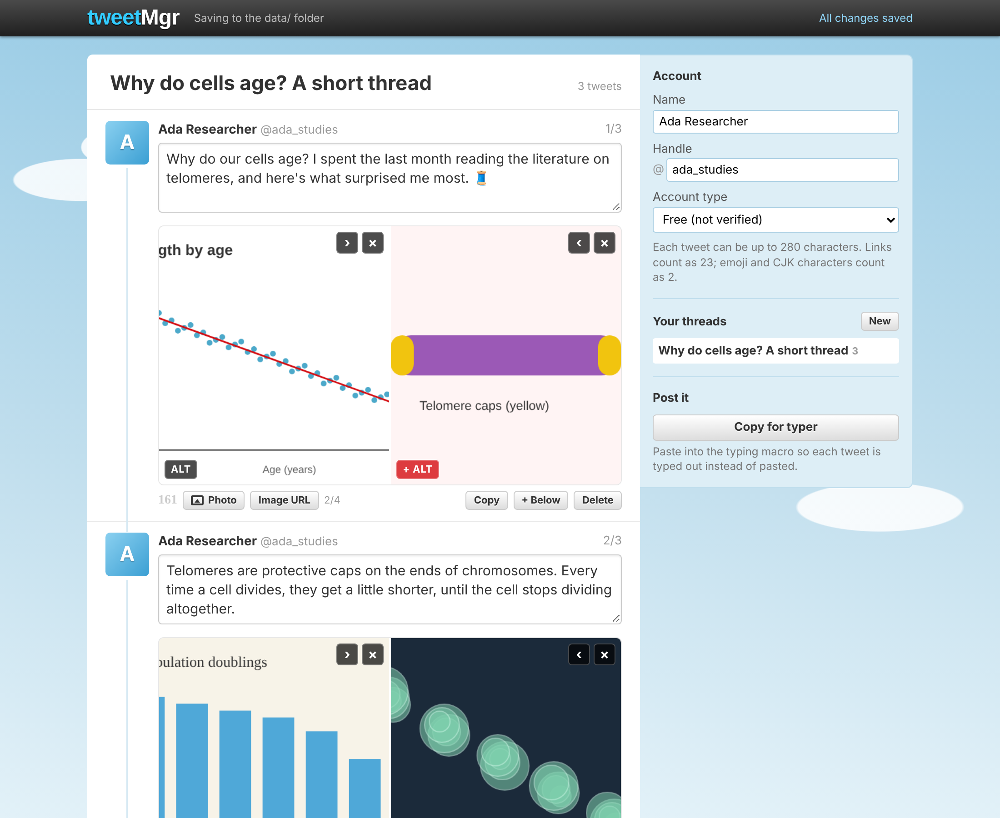

# tweetMgr

A small, locally run app for drafting Twitter/X threads: write tweets with a live character counter for your account type, save drafts, and reload them later. Threads are stored as plain JSON files, so scripts and AI agents can read and edit them too.



## Run it

Requires Node.js 18 or newer. There are no dependencies to install.

```sh
npm start          # http://localhost:4321
npm test
```

Set `PORT`, `HOST`, or `TWEETMGR_DATA` (the data folder) to override the defaults.

## Where your data lives

Everything is saved to the `data/` folder next to the app, which is gitignored so your drafts never end up in the repo:

```
data/
  profiles/<profileId>.json   your name, handle, and account type
  threads/<threadId>.json     one file per thread
  images/<imageId>            uploaded images (e.g. img_3f9a1c2b7d4e.png)
  settings.json               which profile and thread are open
```

The app picks up changes made to these files by other tools when you switch back to its browser tab. See [docs/DATA_FORMAT.md](docs/DATA_FORMAT.md) for the thread format.

If the app is opened without the local server (for example from a future hosted version), it falls back to storing everything in the browser's IndexedDB.

## Character limits

Choose your account type in the sidebar: Free (280), Premium (25,000), or a custom limit. Counting follows Twitter/X's rules: links count as 23, emoji and CJK characters count as 2.

## Images and alt text

Each tweet can have up to four images, each with alt text (up to 1,000 characters). Add them with the **Photo** button, by pasting a screenshot into a tweet, by dragging a file or an image from a web page onto a tweet, or with **Image URL**.

- Images from your computer are copied into `data/images/`. Browsers don't reveal where a file lives on disk, so the app keeps its own copy.
- Images from the web (dragged, copied with "Copy image", or added by URL) are stored as links only; nothing is downloaded.

Click **+ ALT** on an image to describe it. Images without a description show a red badge so they're easy to spot before posting. Removing an image from a tweet leaves its file in `data/images/`.



## Typing macro

"Copy for typer" copies the thread as JSON for the typing macro in `typer/`, which types each tweet into X's composer instead of pasting it.
