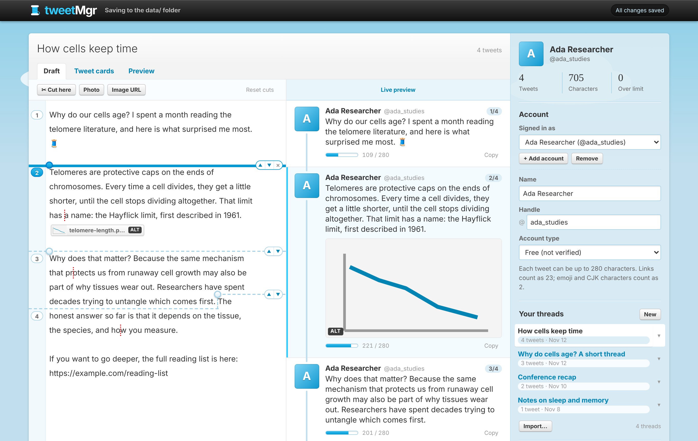
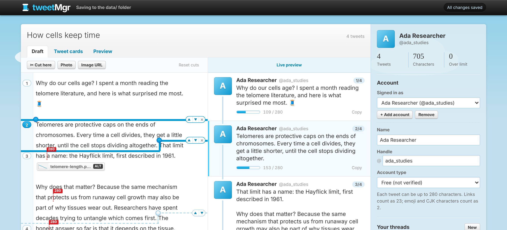
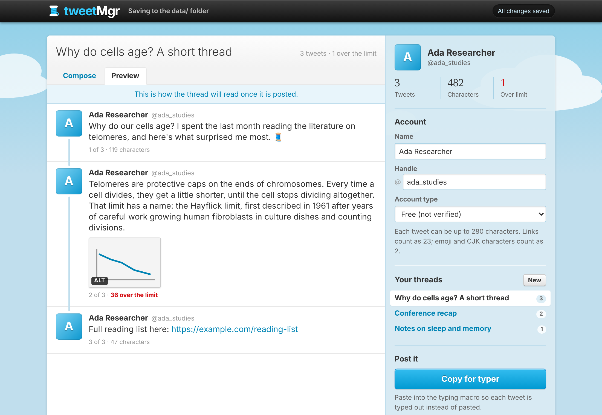

# tweetMgr

A small, locally run app for drafting Twitter/X threads: write the whole thread as one continuous draft, see exactly where each tweet ends, and nudge the cuts until every tweet reads the way you want. Threads are stored as plain JSON files, so scripts and AI agents can read and edit them too.



## Writing a thread

The **Draft** tab has two columns. On the left you just keep typing; on the right the tweets appear as they will be posted.

- **Cut lines** run through the text at the exact character where one tweet ends and the next begins. A dashed line is automatic: it appears when a tweet fills up (at the end of a sentence where it can) and moves as you type. A red dotted tick marks the character where the tweet would hit the limit.
- **Move a cut** by dragging its knob, or with the ▲ ▼ buttons on the line, which send one sentence to the tweet after or bring one back. A cut you move becomes solid and stays put; × (or a double-click on the knob) hands it back to automatic. Hold Alt while dragging to cut at any character instead of between words.
- **Place a cut** anywhere with **✂ Cut here** or Ctrl/⌘+Enter. Backspace right after a cut removes it. Pasting text with `---` lines places a cut at each one.
- **Images** go in with **Photo**, **Image URL**, paste, or drag and drop, and sit in the text as small chips. An image belongs to whichever tweet its chip falls in, so it follows its sentence when a cut moves. Drag a chip (or the picture in the preview) to move it; click either one to edit its description, see where it came from, move it a tweet up or down, or remove it.
- Click a tweet in the preview to jump to it in the draft. Ctrl/⌘+Z undoes text, cuts, and image moves alike.



The **Tweet cards** tab keeps the one-box-per-tweet editor for reordering tweets and other structural work.


## Run it

Requires Node.js 18 or newer. There are no dependencies to install.

```sh
npm start          # http://localhost:4321
npm test
```

Set `PORT`, `HOST`, or `TWEETMGR_DATA` (the data folder) to override the defaults.

## Where your data lives

Everything is saved to the `data/` folder next to the app, which is gitignored so your drafts never end up in the repo:

```
data/
  profiles/<profileId>.json   your name, handle, and account type
  threads/<threadId>.json     one file per thread
  images/<imageId>            uploaded images (e.g. img_3f9a1c2b7d4e.png)
  settings.json               which profile and thread are open
```

The app picks up changes made to these files by other tools when you switch back to its browser tab. See [docs/DATA_FORMAT.md](docs/DATA_FORMAT.md) for the thread format.

If the app is opened without the local server (for example from a future hosted version), it falls back to storing everything in the browser's IndexedDB.

## Command line and AI agents

`bin/tweetmgr.js` lets scripts and AI agents list, read, edit, and check threads, attach figures with alt text, and export for the typer:

```sh
npm link                                   # optional: adds a `tweetmgr` command
tweetmgr list
tweetmgr show latest
tweetmgr edit latest 2 "Revised second tweet"
tweetmgr image add latest 3 ./fig.png --alt "Bar chart of results"
tweetmgr check latest
```

Run `tweetmgr --help` for every command, and see [docs/AGENT_GUIDE.md](docs/AGENT_GUIDE.md) for a guide aimed at agents.

## Character limits

Choose your account type in the sidebar: Free (280), Premium (25,000), or a custom limit. Counting follows Twitter/X's rules: links count as 23, emoji and CJK characters count as 2.

## Images and alt text

Each tweet can have up to four images, each with alt text (up to 1,000 characters). In the Tweet cards tab, add them with the **Photo** button, by pasting a screenshot into a tweet, by dragging a file or an image from a web page onto a tweet, or with **Image URL**.

- Images from your computer are copied into `data/images/`. Browsers don't reveal where a file lives on disk, so the app keeps its own copy.
- Images from the web (dragged, copied with "Copy image", or added by URL) are stored as links only; nothing is downloaded.

Click **+ ALT** on an image to describe it. Images without a description show a red badge so they're easy to spot before posting. Removing an image from a tweet leaves its file in `data/images/`.


## Look and feel

The app wears "Early Bird", an original theme that pays homage to early-2010s microblogging. Every color, font, and radius is a CSS variable at the top of `public/css/theme.css`, and `/styleguide.html` shows each component live. The Preview tab shows the thread as a read-only timeline.



## Typing macro

[`typer/`](typer/) types each tweet into X for you instead of pasting it. "Copy for typer" in the app copies the thread as JSON for it. See [typer/README.md](typer/README.md).

## Splitting and arranging

These tools live in the Tweet cards tab.

- **Split a long draft…** turns a pasted essay into tweets, breaking at paragraphs, then sentences, then words. A line with just `---` forces a break; "Number tweets" adds `1/n` suffixes.
- **Fit ↓** appears on a tweet that's over the limit and moves the extra text into the next tweet. **Fit all to limit** does it for the whole thread.
- **Split** (or Ctrl/⌘+Enter) splits at the cursor; **Merge ↓** (or Backspace at the start of a tweet) joins two tweets.
- Reorder with ▲/▼, Alt+↑/↓, or by dragging the handle on the left of a tweet.
