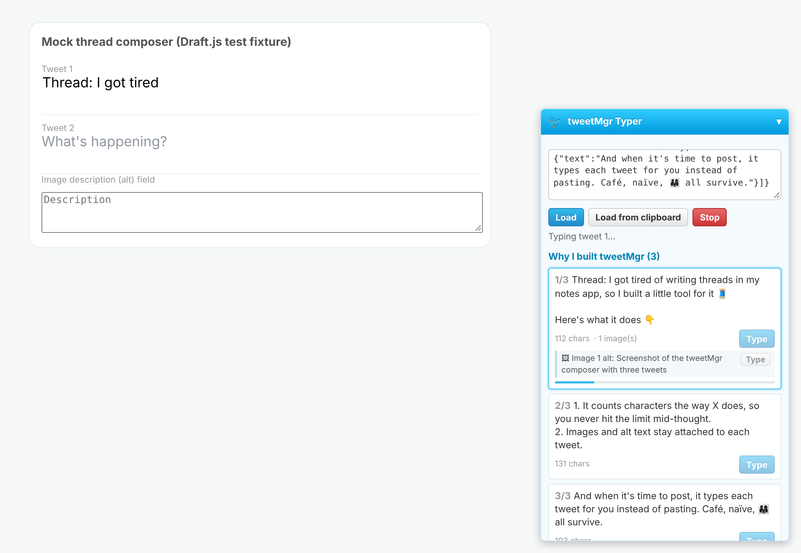
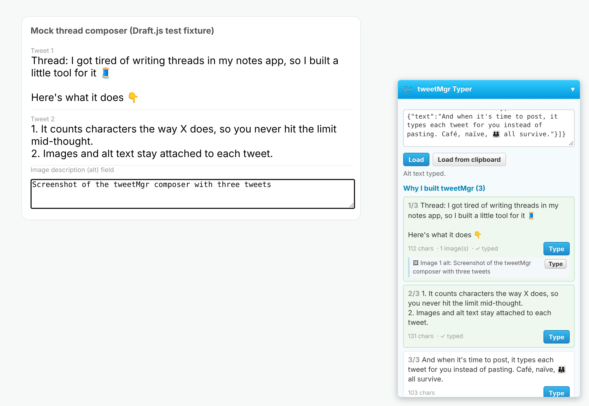

# tweetMgr Typer

Types your pre-written tweets into X's compose box one character at a time,
instead of pasting them. Two ways to use it:

| | Browser userscript (recommended) | Desktop script (fallback) |
|---|---|---|
| File | [`tweetmgr-typer.user.js`](tweetmgr-typer.user.js) | [`type_tweets.py`](type_tweets.py) |
| Runs | Inside x.com, as a small panel | In a terminal, sends real OS key presses |
| Needs | Tampermonkey or Violentmonkey | Python 3 + `pip install pynput` |
| Images & alt text | Shows them per tweet; types alt text too | Text only |

Nothing is ever posted for you. You review each tweet and press **Post** yourself.



## Browser userscript

1. Install [Tampermonkey](https://www.tampermonkey.net/) or
   [Violentmonkey](https://violentmonkey.github.io/).
2. Open the raw [`tweetmgr-typer.user.js`](tweetmgr-typer.user.js) file
   (the "Raw" button on GitHub); your userscript manager will offer to install it.
   - **Chrome/Edge:** userscript managers need "Allow User Scripts" turned on for
     the extension (Extensions > Tampermonkey > Details), or Developer mode on.
3. Open x.com. A blue **tweetMgr Typer** panel appears in the bottom right
   (click its header to collapse it).
4. In tweetMgr, press **Copy for typer**, then press **Load from clipboard** in
   the panel. You can also paste into the panel's box and press **Load**, using
   either the tweetMgr JSON or plain text with tweets separated by a line
   containing only `---`.
5. Click into X's compose box and press **Type** next to a tweet, or press
   **Alt+Shift+T** to type the next untyped tweet without touching the mouse.
   For a thread, press **+** in X to add the next box, click into it, and repeat.
6. For images, attach the file in X as usual, open the image's description
   field, click into it, and press the small **Type** button next to that
   image's alt text.

**Stop** cancels typing mid-tweet. **Settings** lets you change the delay per
character (default 35 to 110 ms, with longer pauses after punctuation).

The thread you loaded and which tweets are done are kept in the userscript
manager's own storage, so they survive page reloads.

## Desktop script

```sh
pip install pynput
python typer/type_tweets.py my-thread.json          # walks through each tweet
python typer/type_tweets.py my-thread.json --tweet 2
```

The script also reads tweetMgr's saved thread files directly, for example
`python typer/type_tweets.py data/threads/<id>.json`. The userscript accepts
that same file format if you paste it into the panel.

It counts down a few seconds so you can click into X's compose box, then
types. On macOS, give your terminal Accessibility permission first. Because
these are real key presses, it works in any browser or app, but it types into
whatever window has focus, so don't switch windows while it runs.

## Does X actually penalize pasted text?

Short answer: **there's no public evidence that X down-ranks a post because
its text was pasted into the composer.** What we found:

- X's official [copypasta and duplicate content policy](https://help.twitter.com/en/rules-and-policies/copypasta-duplicate-content)
  limits the reach of text *duplicated from someone else's post*, "by any
  means". It's about the content being a copy, not about the paste key.
  Typing a copied viral post doesn't avoid it; pasting your own original
  writing isn't covered by it.
- X has also cracked down on accounts that repost other creators' content
  ([TechCrunch](https://techcrunch.com/?p=3143347),
  [Social Media Today](https://www.socialmediatoday.com/news/twitter-implements-new-rules-to-limit-the-reach-of-duplicated-tweets/623531/)).
  Same idea: duplicated content, not the paste action.
- The "pasting gets you down-ranked" claim circulates on social media, but
  we couldn't find a statement from X or a controlled test backing it.
  Technically, X's web app *could* log paste events, so it isn't impossible,
  just unproven.

So treat the typer as cheap insurance and a convenience (it also handles alt
text and keeps your place in the thread), not as a proven reach boost.

## Risks and limits

- **Terms of service.** X's rules prohibit automated posting and inauthentic
  activity. The typer only fills the compose box when you click; you still
  post manually, at human speed, your own original text. That's comparable to
  a text-expander or accessibility tool, but it is still browser automation,
  so use it at your own discretion.
- **Detectability.** The userscript feeds X's editor the same events the
  browser produces for typing (`textInput`, which React turns into
  `onBeforeInput`), with no paste events. Those events are script-generated,
  so a site that checked `event.isTrusted` could tell them apart from real
  keys. The desktop script sends genuine OS key presses and has no such tell.
- **X changes its site.** The userscript targets the editor X has long used (Draft.js)
  and falls back to the browser's standard text insertion for other editors.
  If X ships a new editor and typing stops working, the desktop script still
  works.

## How it was tested

The userscript was run against a local Draft.js editor (the editor library
X has used for its composer) in headless Chromium. All three cases produced exactly the
expected text, including emoji and line breaks, with **zero paste events**:
clicking **Type** for tweet 1, **Alt+Shift+T** for tweet 2, and typing alt text
into a plain text field.


